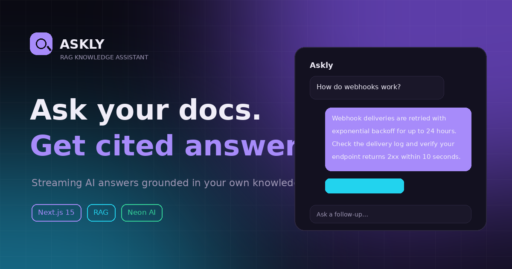

# Askly — RAG Knowledge Assistant

> Ask questions about your documents and get streaming AI answers with cited sources.


---

## ✨ What it does

Askly is a complete retrieval-augmented generation (RAG) app. You add documents, Askly chunks and embeds them, finds the most relevant passages for a question, and streams an answer that cites its sources.

- **Document ingestion** — paste text or upload `.txt` / `.md` files; paragraph-aware chunking with overlap
- **Hybrid embedding layer** — Neon AI Gateway embeddings when configured, deterministic hashed embeddings otherwise
- **Semantic retrieval** — cosine-similarity ranking over every chunk with a configurable top-K
- **Streaming answers** — token-by-token SSE from the gateway, with an extractive fallback that also streams
- **Cited sources** — every answer shows clickable source chips with the supporting passage
- **Sample knowledge base** — one click loads four realistic docs so the demo is never empty
- **Two-mode badge** — clearly shows *Live AI* vs *Local mode* in the UI
- **Optional pgvector schema** — production-ready Neon Postgres tables and HNSW index

## 🧠 How the RAG pipeline works

```
Document → chunk (620 chars / 90 overlap) → embed → vector store
Question → embed → cosine similarity → top 4 chunks → prompt → streamed answer + [citations]
```

No keys needed: the local fallback uses hashed unigram + bigram embeddings, so retrieval and the demo answer engine still work end to end.

## 🛠️ Tech stack

| Layer | Choice |
|---|---|
| Framework | Next.js 15 (App Router, React 19) |
| Language | TypeScript (strict) |
| Styling | Tailwind CSS v4 |
| AI | Neon AI Gateway — chat completions + embeddings (OpenAI-compatible) |
| Vectors | Cosine similarity over embedded chunks; optional Neon pgvector + HNSW |
| Streaming | Web Streams API + SSE (`text/event-stream`) |
| Icons | Lucide React |

## 🚀 Run locally

```bash
git clone https://github.com/<your-username>/askly.git
cd askly
npm install
cp .env.example .env.local   # optional
npm run dev
```

Open [http://localhost:3000](http://localhost:3000), click **Load sample knowledge base**, then ask e.g. *"How do webhooks work?"*

## 🔌 Environment (all optional)

| Variable | Purpose |
|---|---|
| `NEON_AI_GATEWAY_BASE_URL` | Bare branch host from Neon Console → Connect → AI Gateway |
| `NEON_AI_GATEWAY_TOKEN` | Gateway credential (`nt_live_...`) |
| `NEON_AI_GATEWAY_MODEL` | Defaults to `gpt-5-mini` |
| `NEON_EMBEDDING_MODEL` | Defaults to `text-embedding-3-small` |
| `DATABASE_URL` | Optional Neon Postgres; schema in `scripts/seed.sql` |

```bash
psql "$DATABASE_URL" -f scripts/seed.sql
```

## 📡 API

| Endpoint | Description |
|---|---|
| `POST /api/ingest` | `{ name, content }` or `{ sample: true }` — chunk, embed and store |
| `GET /api/documents` | List ingested documents and chunk counts |
| `DELETE /api/documents?id=<id>` | Delete one document, or all when no id |
| `POST /api/chat` | `{ question, history }` — SSE stream of `sources`, `delta`, `done` events |
| `GET /api/health` | Mode, document count and chunk count |

## 📁 Structure

```
src/
├── app/api/{chat,ingest,documents,health}/route.ts
├── components/{ChatApp,DocumentPanel,MessageBubble}.tsx
└── lib/{chunk,embeddings,gateway,retrieval,sample-docs,store,types}.ts
scripts/{seed.sql,generate_cover.py}
```

## 📸 Cover



Regenerate with `python3 scripts/generate_cover.py`.

## 🎯 Portfolio blurb

> Built Askly, a RAG-powered knowledge assistant with streaming AI answers and cited sources. Implemented document chunking, embedding generation through Neon AI Gateway, cosine-similarity retrieval, and an SSE streaming chat UI in Next.js 15 + TypeScript. Added a deterministic local fallback so the app is fully demoable without API keys, plus an optional pgvector schema for production.

## ✅ Quality checks

```bash
npm run lint
npm run typecheck
npm run build
```

## License

MIT — free to use for personal and commercial projects.
